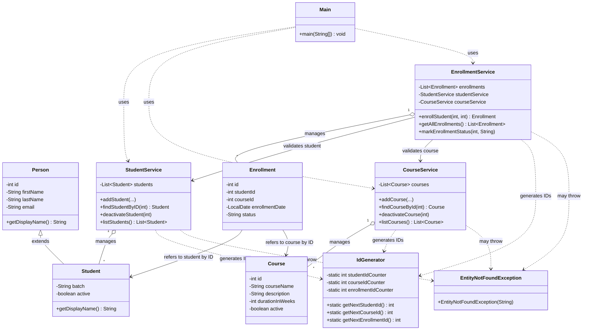

# LearnTrack

Student & Course Management System - Core Java Project

## Features
- Student Management
- Course Management
- Enrollment Management
- Console-based UI

## How to Run
```bash
javac -d out src/com/airtribe/learntrack/**/*.java
java -cp out com.airtribe.learntrack.ui.Main
```
## Class Diagram

